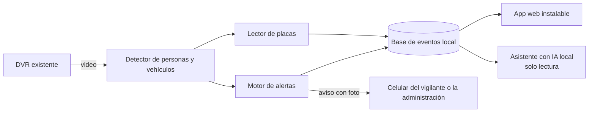
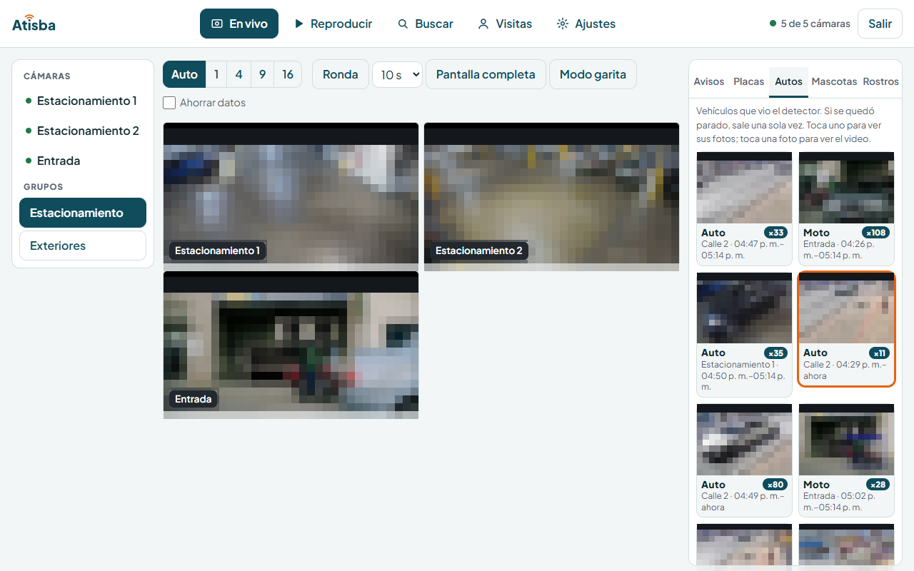
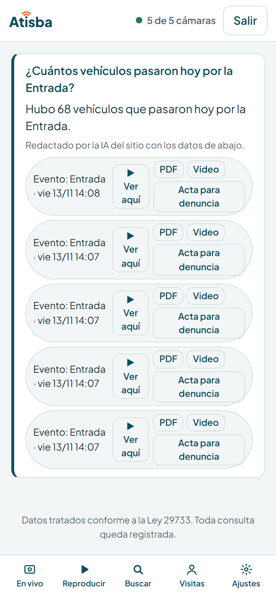

# Caso de estudio: videovigilancia inteligente sobre cámaras existentes

> Este caso no incluye código, precios, plan de negocio ni nombres de clientes; las capturas tienen el video pixelado y las placas anonimizadas. El repositorio del producto es privado.

**Proyecto:** Atisba Garita (prototipo, 2026) · **Mi rol:** Product Owner y desarrollo asistido por IA · **Estado:** prototipo probado en laboratorio y en una PC servidor real

## El problema

Muchos condominios y locales pequeños en el Perú ya tienen cámaras y un DVR, pero nadie puede mirar 8 o 16 cámaras a la vez. El vigilante de la garita anota las placas a mano, los incidentes se descubren al día siguiente y buscar un momento en la grabación toma mucho tiempo. Cambiar todo el equipo por cámaras "con IA" es caro y desperdicia lo que ya se pagó.

**Pregunta de producto:** ¿se puede agregar la inteligencia **sin cambiar las cámaras ni el DVR** y con un uso que entienda un vigilante o un residente?

## La solución

Una capa de software que se instala en un equipo dentro del local y se conecta al DVR existente:

- **Lectura de placas** y bitácora automática de entradas y salidas.
- **Alertas con contexto**, con foto: vehículo desconocido de noche, placa en alerta, cámara tapada, movida o sin grabación.
- **App web instalable** (celular y PC) con video en vivo, línea de tiempo de 24 horas y descarga de grabaciones.
- **«Pregúntale a Atisba»:** preguntas en español sobre los eventos («¿ya llegó mi visita?»), respondidas por una IA que corre **en el propio equipo** y solo puede leer datos, nunca actuar.
- **Visitas con QR** (solo nombre y placa, sin DNI), roles (administración, vigilante, residente, auditor) y segundo factor obligatorio para administradores.

*Capturas reales de la prueba en la PC servidor, con el video pixelado y las placas reemplazadas por «ABC-123».*

**Decisión clave:** el video y los datos personales **no salen del local**. La IA corre en la GPU del equipo y el acceso desde fuera pasa por un relé que no descifra el contenido.

## Cómo trabajé

1. **Producto primero:** definí segmentos (condominios con garita, locales pequeños), analicé la competencia y prioricé un backlog por sprints. Cada decisión importante quedó registrada como decisión de arquitectura (ADR) con su alternativa descartada.
2. **Construcción con IA y verificación propia:** usé agentes de IA para programar y revisar código. Ningún cambio se integró sin pruebas automatizadas, y la integración continua revisa estilo, tipos, seguridad, dependencias vulnerables y secretos en cada cambio.
3. **Laboratorio sin hardware:** armé un DVR simulado para probar todo el flujo sin cámaras reales y repetir las pruebas cuantas veces hiciera falta.
4. **Prueba real:** instalé el sistema en una PC servidor con GPU y un DVR real para comprobar que lo del laboratorio funcionaba en la práctica.
5. **Cumplimiento desde el diseño:** elegí solo componentes con licencias aptas para uso comercial (MIT, Apache, BSD) y el sistema **no hace reconocimiento facial**: no identifica a nadie. El módulo de rostros es opcional y solo para residentes y trabajadores que lo autoricen, en línea con la guía de la Autoridad Nacional de Protección de Datos Personales (Ley 29733).

## Resultados

| Indicador | Resultado |
|---|---|
| Pruebas automatizadas | **808**, con 97 % de cobertura del código del servidor |
| Decisiones de arquitectura documentadas | **43** |
| Auditorías internas | 2 auditorías integrales y una prueba de intrusión sin riesgos altos ni medios |
| Versiones entregadas | 0.1 a 0.14, con registro de cambios en cada una |

## Lo que la prueba real me enseñó

El laboratorio no lo encuentra todo. En la PC real aparecieron errores que ninguna prueba simulada había detectado:

- **La detección venía apagada.** El detector de video deja la detección desactivada por defecto en su versión 0.16. En la laptop "no se veían autos" y parecía un problema de la cámara; en la PC real encontré la causa, la corregí y agregué una prueba para que no vuelva a pasar.
- **La IA inventaba cosas.** El resumen diario afirmaba "se verificaron las placas" en días sin eventos, y el asistente decía que había "registrado" algo cuando solo puede leer. Lo corregí con tres reglas: si no hay datos, no se llama a la IA; la IA solo puede usar herramientas de lectura; y se descarta toda respuesta que afirme una acción.
- **El tono no era el del cliente.** El modelo usaba jerga de otros países («che», «chido»). Ajusté las instrucciones para un español neutro y agregué un filtro final.

**Lo que me llevo:** con IA se construye rápido, pero el valor está en decidir qué construir, probarlo con datos reales y no confiar en una respuesta solo porque suena bien.

---
*Proyecto privado y confidencial. Este documento resume el trabajo sin exponer código, datos de clientes ni información comercial.*
